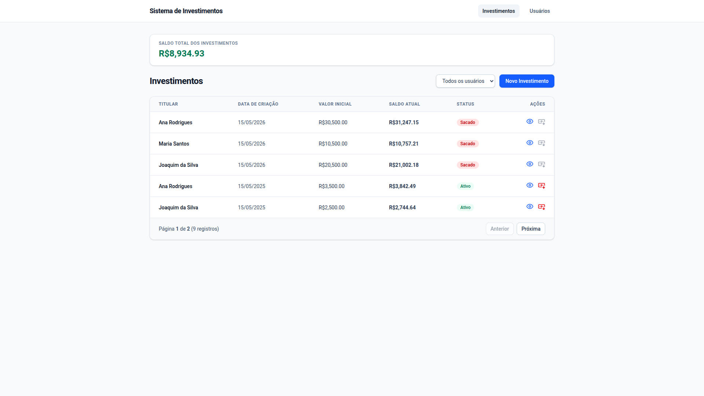
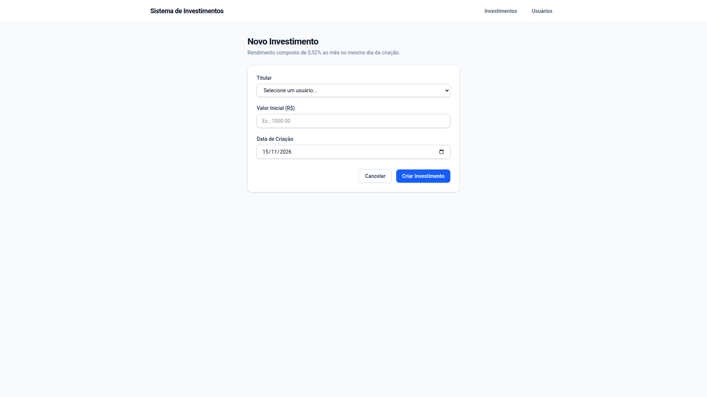
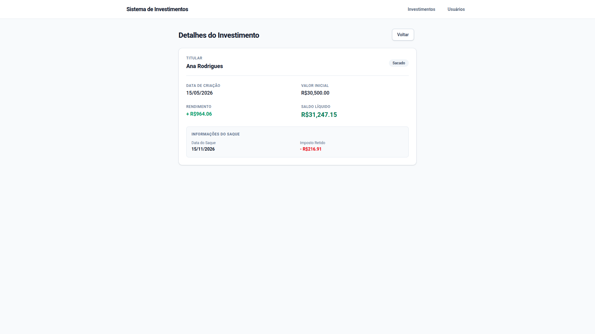
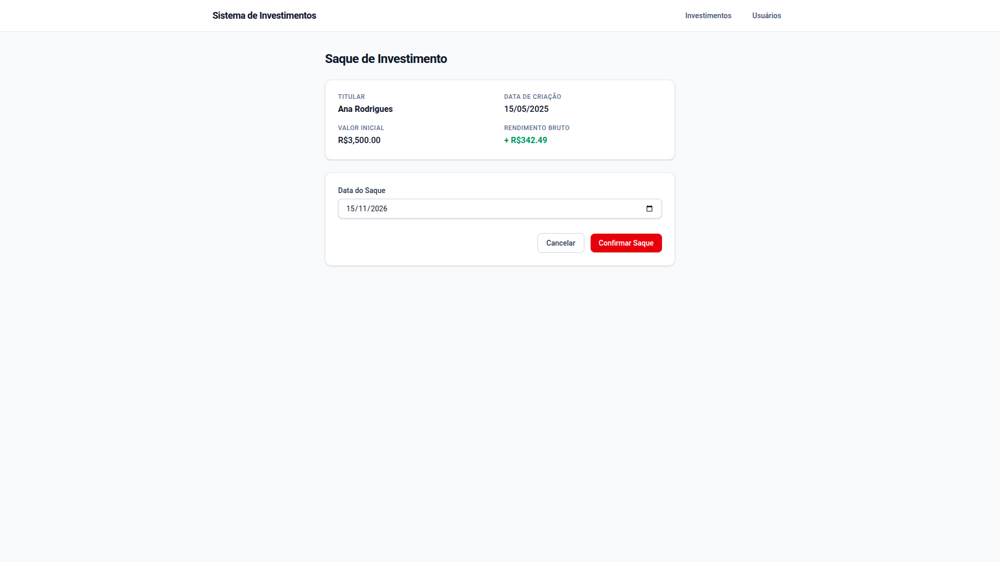
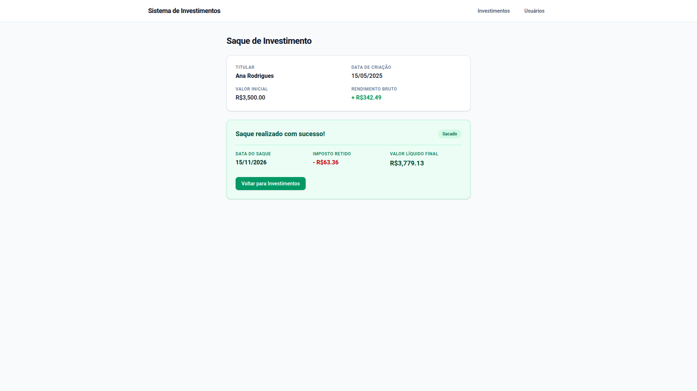
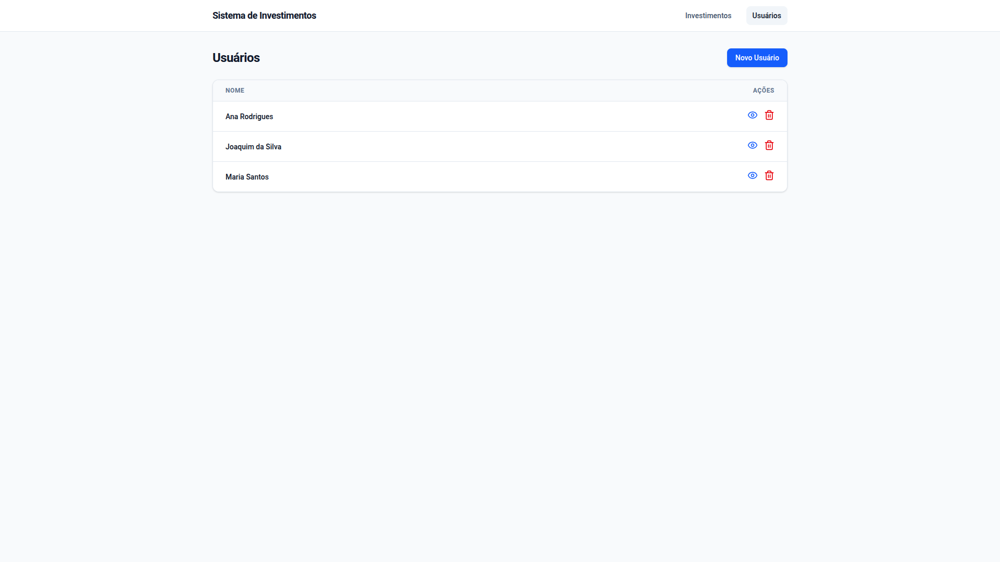
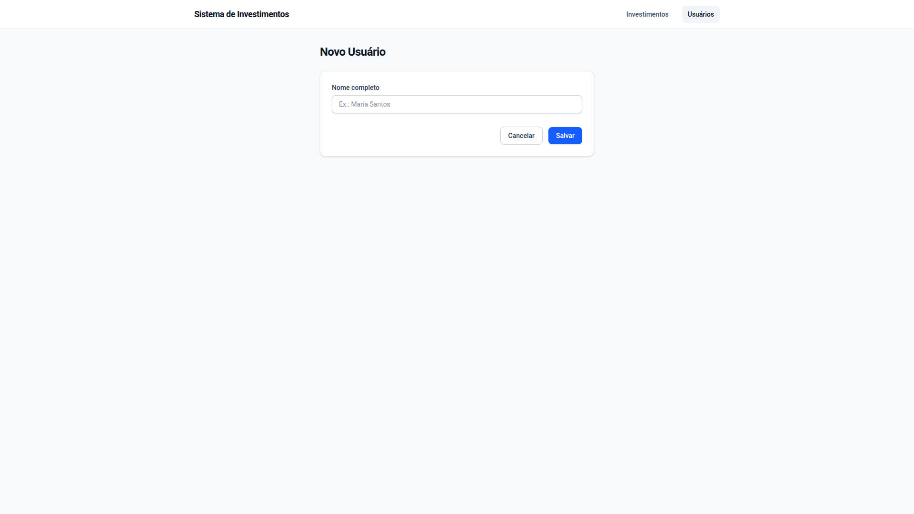
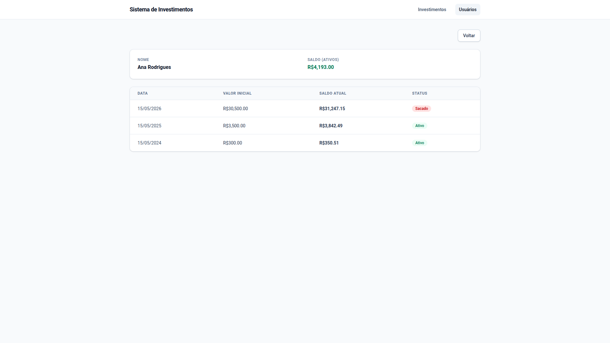
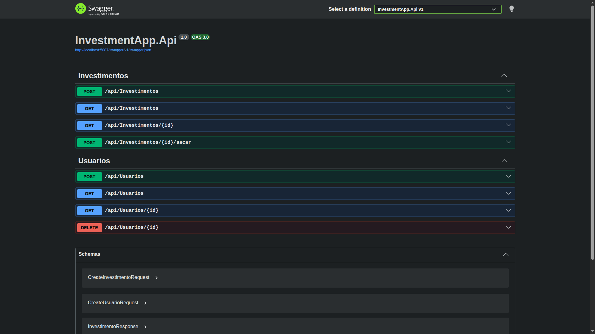

# InvestApp — Gestão de Investimentos

Aplicação Full Stack para criação, acompanhamento de rendimentos compostos (`0,52%` ao mês) e resgate de investimentos com aplicação de imposto regressivo (`22,5%`, `18,5%` e `15%`).

---

## Pré-requisitos

- [.NET 8 SDK](https://dotnet.microsoft.com/download/dotnet/8.0)
- `dotnet-ef` CLI
- [Node.js](https://nodejs.org/) (v20+) e `npm`
- [Angular CLI](https://angular.dev/)
- MySQL 8+

---

## Como rodar o projeto

### 1. Backend (.NET 8 Web API + MySQL)

1. Entre na pasta da API:
   ```bash
   cd backend/InvestmentApp.Api
   ```
   
2. Confira a string de conexão em `appsettings.Development.json`.

3. Aplique as migrations para criar o banco e as tabelas:
   ```bash
   dotnet ef database update
   ```

4. Inicie a API (perfil `http` na porta `5087`):
   ```bash
   dotnet run
   ```
   > Ao rodar a API, o `DbInitializer` gera automaticamente seeds com 3 usuários e 9 investimentos de exemplo.

### 2. Documentação da API (Swagger)

Com o backend rodando, acesse a documentação interativa em:
- **Swagger UI:** http://localhost:5087/swagger

### 3. Testes Unitários (Backend)

Na pasta `backend/`, execute:
```bash
dotnet test
```

### 4. Frontend (Angular 21 + TypeScript)

1. Em outro terminal, entre na pasta do frontend e instale as dependências:
   ```bash
   cd frontend
   npm install
   ```

2. Confirme a URL da API em `src/environments/environments.ts` (`http://localhost:5087/api`).

3. Inicie o servidor de desenvolvimento:
   ```bash
   ng serve
   ```

4. Acesse no navegador: http://localhost:4200


---

## Bibliotecas Utilizadas

### Backend
- **Entity Framework Core + Driver MySQL:** Utilizado para mapear entidades e executar migrations no MySQL.
- **EF Core Migrations CLI:** Ferramenta usada para aplicar migrations via `dotnet ef`.
- **Swagger UI:** Interface para documentação e testes dos endpoints.
- **xUnit (v2.4.2):** Framework de testes unitários.

### Frontend
- **Tailwind CSS:** Biblioteca de estilização para web.
- **Lucide Angular:** Biblioteca de ícones SVG.

---

## Screenshots

### Listagem de Investimentos


### Novo Investimento


### Detalhes do Investimento


### Saque de Investimento



### Gestão de Usuários




### Documentação da API (Swagger)
